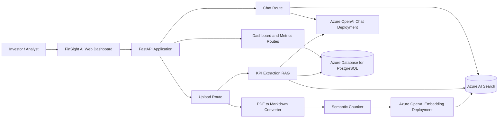
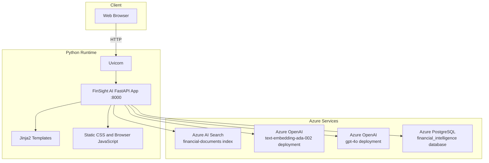
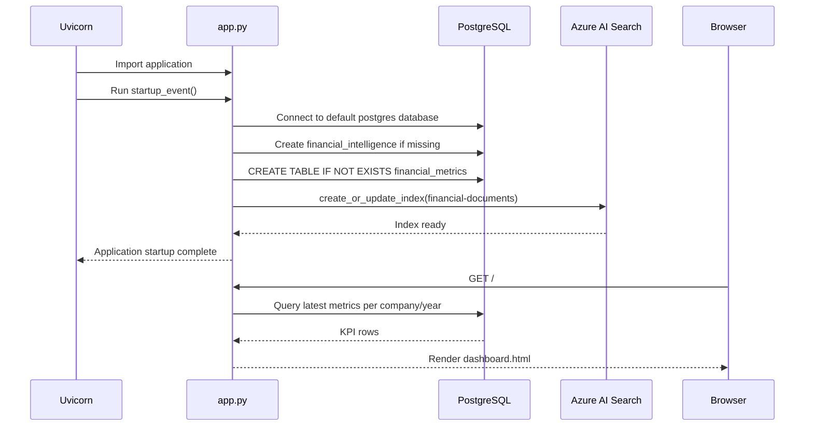
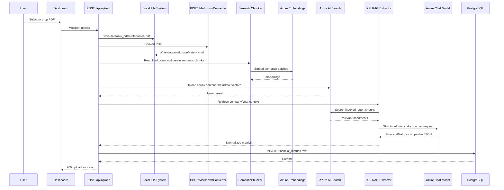
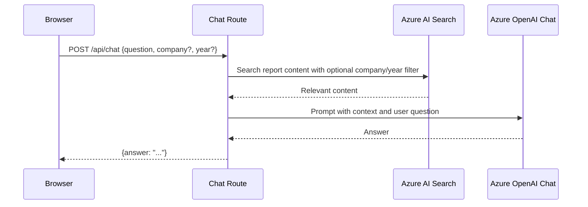
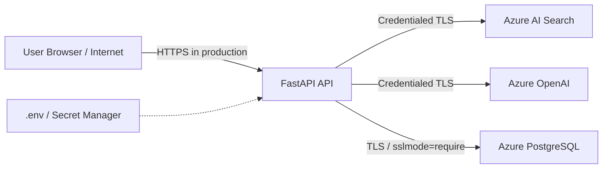

# FinSight AI - Project Architecture and Implementation Specification

## 1. Project Summary

FinSight AI is a financial-investor intelligence platform that converts corporate annual-report PDFs into searchable financial knowledge and structured key performance indicators (KPIs).

The platform provides:

- PDF upload and batch ingestion
- PDF-to-Markdown conversion
- Semantic document chunking using Azure OpenAI embeddings
- Azure AI Search indexing and retrieval
- Retrieval-augmented generation (RAG) for KPI extraction
- Structured extraction of financial metrics, risks, and growth drivers
- PostgreSQL persistence for dashboard metrics
- A browser dashboard for KPI comparison and qualitative insights
- An AI analyst chat experience grounded in indexed corporate reports

The product-facing name is **FinSight AI**.

---

## 2. System Goals

### Functional goals

1. Accept annual reports and other corporate financial PDFs.
2. Identify the company and fiscal year from the filename.
3. Convert PDF content into Markdown.
4. Split Markdown into semantically meaningful chunks.
5. Generate embeddings for each chunk.
6. Store chunks and metadata in Azure AI Search.
7. Retrieve relevant report sections for a selected company and year.
8. Extract structured financial metrics with Azure OpenAI.
9. Save extracted metrics to PostgreSQL.
10. Display metrics in a dashboard using compact USD formatting.
11. Answer natural-language questions through the AI analyst chat.

### Non-functional goals

- Keep secrets outside source control.
- Use managed Azure services for search, model inference, and PostgreSQL.
- Preserve report metadata (`company`, `year`, and `source_file`) for filtering and traceability.
- Allow the same ingestion pipeline to run from the command line or the web upload endpoint.
- Expose a health endpoint for local and deployment checks.

---

## 3. High-Level Architecture



### Logical component responsibilities

| Component | Responsibility |
|---|---|
| Browser dashboard | Upload PDFs, show progress, render KPIs, select companies, send chat questions |
| FastAPI application | HTTP routing, startup initialization, template rendering, error propagation |
| PDF converter | Convert PDF pages to Markdown using `pymupdf4llm` |
| Semantic chunker | Split Markdown based on embedding-distance breakpoints |
| Embedding model | Convert chunks and semantic-split sentences into vectors |
| Azure AI Search | Store searchable chunks, vectors, company metadata, and source filenames |
| KPI RAG extractor | Retrieve report context and request structured financial output |
| Chat model | Produce natural-language financial answers |
| PostgreSQL | Store the latest KPI row for each company and fiscal year |

---

## 4. Deployment Topology



### Current runtime

- Application entry point: `app.py`
- Server: Uvicorn
- Host: `0.0.0.0`
- Port: `8000`
- Browser URL: `http://localhost:8000`
- Health URL: `http://localhost:8000/health`

`main.py` is a separate, older/alternate FastAPI entry point that uses port `8080` and only includes the legacy dashboard and health routers. The complete FinSight AI application is started with `app.py`.

---

## 5. Repository Structure

```text
.
├── app.py                         # Primary FastAPI application
├── main.py                        # Legacy/alternate FastAPI entry point
├── requirements.txt               # Python dependency pins
├── README.md                      # Basic setup documentation
├── project.md                     # This architecture specification
├── .env                           # Local secrets and service configuration
├── config/
│   ├── azure.py                   # Azure configuration module
│   └── settings.yaml              # Placeholder configuration example
├── database/
│   ├── create_table.py            # financial_metrics table creation
│   ├── metrics.py                 # Dashboard metric queries
│   ├── postgres_sql.py            # PostgreSQL engine and database creation
│   └── save_metrics.py            # KPI persistence
├── ingestion/
│   ├── ingest_documents.py        # End-to-end ingestion orchestration
│   ├── pdf_to_markdown.py         # PDF conversion
│   └── semantic_chunker.py        # Embedding-based chunking
├── llm/
│   └── azure_openai.py            # Azure chat client and structured completion
├── rag/
│   ├── kpi_extractor_rag.py       # Retrieval and FinancialMetrics schema
│   └── retrieval_debug.py         # Search troubleshooting utility
├── routes/
│   ├── chat.py                    # POST /api/chat
│   ├── dashboard.py               # Legacy metrics route
│   ├── health.py                  # Legacy health route
│   └── ingestion.py               # POST /api/upload
├── vectorstore/
│   ├── azure_ai_search.py         # Search client, upload, and retriever
│   └── create_index.py            # Azure AI Search index definition
├── templates/
│   └── dashboard.html             # FinSight AI dashboard
├── static/
│   └── style.css                  # Dashboard styling
├── data/
│   ├── raw_pdfs/                  # Input PDF reports
│   └── markdown/                  # Generated Markdown files
└── notes/                         # Existing design and presentation artifacts
```

---

## 6. Application Startup Flow



Startup performs the following:

1. Loads `.env` using `python-dotenv`.
2. Calls `create_database()` to connect to the default PostgreSQL database and create the configured target database if needed.
3. Calls `create_tables()` to create `financial_metrics`.
4. Calls `create_index()` to create or update the Azure AI Search index.
5. Registers `/api/upload`, `/api/chat`, `/`, `/api/metrics`, and `/health`.

If PostgreSQL is unreachable, startup fails before the application can serve chat or upload requests.

---

## 7. Document Ingestion Flow

### 7.1 End-to-end ingestion sequence



### 7.2 Filename convention

The ingestion parser extracts metadata from filenames:

- `2024_Apple.pdf` → company `Apple`, year `2024`
- `2024_AnnualReport_Apple.pdf` → company `Apple`, year `2024`
- `Apple_2024.pdf` → company `Apple`, year `2024`

For reliable ingestion, use:

```text
<year>_<company>.pdf
```

Example:

```text
2024_Nvidia.pdf
```

The current parser uses the first numeric token as the year and, for year-prefixed names, uses the final underscore-separated token as the company.

### 7.3 Ingestion implementation modules

| Module | Main function/class | Role |
|---|---|---|
| `ingestion/pdf_to_markdown.py` | `PDFToMarkdownConverter.convert_pdf` | Validates the input PDF and writes Markdown |
| `ingestion/semantic_chunker.py` | `chunk_markdown` | Reads Markdown and creates semantic `Document` chunks |
| `vectorstore/azure_ai_search.py` | `AzureAISearchVectorStore.upload_chunks` | Embeds chunks and uploads Search documents |
| `rag/kpi_extractor_rag.py` | `extract_financial_metrics` | Retrieves context and extracts KPIs |
| `database/save_metrics.py` | `save_metrics` | Persists normalized metrics |
| `routes/ingestion.py` | `upload_document` | HTTP upload adapter |

---

## 8. RAG and KPI Extraction Flow

```mermaid
flowchart LR
    Question[Company and fiscal year] --> Query[Build retrieval query]
    Query --> Filter[Search filter:\ncompany + year]
    Filter --> Search[(Azure AI Search)]
    Search --> Context[Top report chunks]
    Context --> Prompt[Extraction prompt]
    Prompt --> Chat[Azure OpenAI chat deployment]
    Chat --> JSON[Structured JSON response]
    JSON --> Schema[FinancialMetrics Pydantic schema]
    Schema --> Normalize[Normalize aliases and target year]
    Normalize --> PostgreSQL[(financial_metrics)]
```



### Extracted KPI fields

The `FinancialMetrics` model supports:

- `revenue`
- `net_income`
- `operating_income`
- `cash_flow`
- `total_assets`
- `total_liabilities`
- `risk_factors`
- `growth_drivers`

The extractor accepts multiple model key styles, including:

- `Revenue`, `revenue`
- `Net Income`, `Net_Income`, `NetIncome`, `net_income`
- `Operating Income`, `Operating_Income`, `OperatingIncome`, `operating_income`
- `Cash Flow from Operating Activities`, `Cash_Flow_from_Operating_Activities`, `CashFlowFromOperatingActivities`, `cash_flow`
- `Total Assets`, `Total_Assets`, `TotalAssets`, `total_assets`
- `Total Liabilities`, `Total_Liabilities`, `TotalLiabilities`, `total_liabilities`
- `Top Risk Factors`, `Top_Risk_Factors`, `TopRiskFactors`, `risk_factors`
- `Top Growth Drivers`, `Top_Growth_Drivers`, `TopGrowthDrivers`, `growth_drivers`

Financial values may be returned either as scalar values or year-keyed dictionaries. The extractor normalizes a dictionary to the requested fiscal year before persistence.

### Chat flow



The current chat retriever uses Azure AI Search text search with optional metadata filtering. Vectors are stored for the chunks, but the current `Retriever.invoke` implementation uses `search_text` rather than constructing an Azure Search vector query.

---

## 9. Data Model

### 9.1 Azure AI Search index

Index name is configured by `AZURE_SEARCH_INDEX_NAME`, currently `financial-documents`.

| Field | Type | Properties | Description |
|---|---|---|---|
| `id` | String | Key | UUID for one indexed chunk |
| `company` | String | Filterable | Company parsed from the PDF filename |
| `year` | String | Filterable | Fiscal year parsed from the filename |
| `source_file` | String | Filterable | Original PDF filename |
| `content` | String | Searchable | Markdown chunk text |
| `content_vector` | Collection(Single) | Vector field | Embedding vector, default dimension 1536 |

The index uses an HNSW algorithm configuration and a `vector-profile`.

### 9.2 PostgreSQL `financial_metrics` table

```sql
CREATE TABLE IF NOT EXISTS financial_metrics (
    id SERIAL PRIMARY KEY,
    company VARCHAR(100),
    year VARCHAR(10),
    revenue TEXT,
    net_income TEXT,
    operating_income TEXT,
    cash_flow TEXT,
    total_assets TEXT,
    total_liabilities TEXT,
    risk_factors TEXT,
    growth_drivers TEXT,
    created_at TIMESTAMP DEFAULT CURRENT_TIMESTAMP
);
```

The dashboard query returns the newest row for each `(company, year)` pair using:

```sql
ROW_NUMBER() OVER (
    PARTITION BY company, year
    ORDER BY created_at DESC
)
```

### 9.3 Stored qualitative values

Risk factors and growth drivers are stored as newline-separated text in PostgreSQL. The dashboard splits these values back into arrays for display.

---

## 10. HTTP API

### `GET /`

Renders the FinSight AI dashboard using `templates/dashboard.html`.

### `GET /health`

Returns:

```json
{
  "status": "healthy"
}
```

This endpoint confirms that the FastAPI process is serving. It does not independently validate every external dependency.

### `GET /api/metrics`

Returns the latest dashboard metrics from PostgreSQL.

### `POST /api/upload`

Accepts a multipart form upload:

```text
file=<PDF file>
```

Successful response:

```json
{
  "message": "Document uploaded successfully",
  "file_name": "2024_Company.pdf"
}
```

The request performs the complete ingestion and KPI persistence pipeline synchronously before returning.

### `POST /api/chat`

Request:

```json
{
  "question": "What was the company's revenue in 2024?",
  "company": "Apple",
  "year": 2024
}
```

Response:

```json
{
  "answer": "..."
}
```

Errors are returned as HTTP 500 responses with the exception detail in the current implementation.

---

## 11. Configuration and Secrets

The application loads `.env` from the repository root. `.env` is ignored by Git and must never be committed.

### Embedding configuration

```env
AZURE_OPENAI_ENDPOINT=https://<embedding-resource>.openai.azure.com/
AZURE_OPENAI_API_KEY=<embedding-api-key>
AZURE_OPENAI_API_VERSION=<embedding-api-version>
AZURE_OPENAI_EMBEDDING_DEPLOYMENT=<embedding-deployment-name>
```

### Chat configuration

The chat client uses its own endpoint, key, API version, and deployment:

```env
AZURE_OPENAI_CHAT_ENDPOINT=https://<chat-resource>.cognitiveservices.azure.com/
AZURE_OPENAI_CHAT_API_KEY=<chat-api-key>
AZURE_OPENAI_CHAT_API_VERSION=<chat-api-version>
AZURE_OPENAI_CHAT_DEPLOYMENT=<chat-deployment-name>
```

### Azure AI Search configuration

```env
AZURE_SEARCH_ENDPOINT=https://<search-service>.search.windows.net
AZURE_SEARCH_API_KEY=<search-admin-or-query-key>
AZURE_SEARCH_INDEX_NAME=financial-documents
```

### PostgreSQL configuration

```env
POSTGRES_HOST=<postgres-server>.postgres.database.azure.com
POSTGRES_PORT=5432
POSTGRES_DATABASE=financial_intelligence
POSTGRES_USER=<postgres-user>
POSTGRES_PASSWORD=<postgres-password>
```

The PostgreSQL server must allow the client public IP through its firewall and must accept TLS connections. The application uses `sslmode=require`.

---

## 12. Local Development Runbook

### Install dependencies

```powershell
uv venv
.\.venv\Scripts\activate
uv pip install -r requirements.txt
```

### Start the complete application

From the repository root:

```powershell
.\.venv\Scripts\python.exe app.py
```

Open:

```text
http://localhost:8000
```

### Check health

```powershell
Invoke-WebRequest http://127.0.0.1:8000/health
```

### Run batch ingestion

```powershell
.\.venv\Scripts\python.exe -m ingestion.ingest_documents
```

### Run KPI extraction directly

```powershell
.\.venv\Scripts\python.exe -m rag.kpi_extractor_rag
```

### Avoid the port collision

Only start one server on port `8000`. If port `8000` is already occupied:

```powershell
Get-NetTCPConnection -LocalPort 8000 -State Listen
```

If the existing server is healthy, reuse it. Otherwise stop only the identified process and start `app.py` again.

---

## 13. Architecture Diagram Generation Guide

### Recommended diagrams

Create these diagrams for a complete technical presentation:

1. **Context diagram** - investor, dashboard, FastAPI, Azure services, and PostgreSQL.
2. **Container diagram** - browser UI, API routes, ingestion services, RAG services, storage adapters, and external services.
3. **Ingestion sequence diagram** - PDF upload through indexing and KPI persistence.
4. **Chat sequence diagram** - user question through Search retrieval and chat generation.
5. **Deployment diagram** - local Python/Uvicorn process connected to Azure managed services.
6. **Data model diagram** - Azure Search document fields and PostgreSQL `financial_metrics`.

### Diagram labels that must be shown

- FinSight AI Web Dashboard
- FastAPI / Uvicorn on port 8000
- PDF-to-Markdown conversion
- Semantic chunking
- Azure OpenAI Embeddings
- Azure AI Search `financial-documents`
- RAG KPI Extractor
- Azure OpenAI Chat Deployment
- Azure PostgreSQL `financial_intelligence`
- `financial_metrics` table
- Company/year metadata filter
- PDF and Markdown local storage

### Mermaid generation prompt

Use the following prompt in a diagram-generation tool:

> Generate a clean, professional C4-style architecture diagram for FinSight AI, a financial-investor intelligence platform. Show a browser dashboard calling a FastAPI/Uvicorn application on port 8000. Inside the application show upload, chat, dashboard, PDF-to-Markdown conversion, semantic chunking, Azure OpenAI embedding client, RAG KPI extractor, and Azure OpenAI chat client. Show Azure AI Search with the `financial-documents` index storing searchable Markdown chunks, company/year/source metadata, and 1536-dimensional vectors. Show Azure PostgreSQL with the `financial_intelligence` database and `financial_metrics` table storing revenue, net income, operating income, cash flow, total assets, total liabilities, risk factors, growth drivers, company, year, and created timestamp. Draw two flows: PDF ingestion to Search and PostgreSQL, and chat question to Search retrieval to Azure OpenAI chat response. Use directional arrows, group local runtime components separately from Azure managed services, and label all trust boundaries and external dependencies.

### Mermaid diagrams included in this document

The diagrams in Sections 3, 4, 6, 7, 8, and 9 can be copied directly into Mermaid-compatible documentation, GitHub, Mermaid Live, or architecture tooling that supports Mermaid.

---

## 14. Operational Considerations and Known Limitations

### Current limitations

- Upload processing is synchronous; large PDFs keep the HTTP request open.
- Upload and ingestion failures are surfaced as HTTP 500 errors.
- The upload route writes the client-provided filename directly under `data/raw_pdfs`; production deployments should sanitize filenames.
- The current Search retriever performs text search. Although vectors are indexed, chat retrieval does not yet submit a vector query.
- Startup performs database and index initialization, so an unavailable PostgreSQL server prevents the API from starting.
- Duplicate ingestion can create duplicate Search chunks and additional PostgreSQL rows; the dashboard hides older rows but Search documents use random UUIDs.
- The dashboard formats values as compact USD amounts for display, while PostgreSQL stores the extracted text representation.
- `main.py` and the legacy route modules are not the primary runtime path.
- The FastAPI startup handler uses the deprecated `on_event("startup")` pattern and can later be migrated to a lifespan handler.

### Recommended production improvements

1. Move ingestion to a background job or queue.
2. Add file type, file size, filename, and PDF validation.
3. Sanitize uploaded filenames and use generated storage IDs.
4. Add idempotency based on company, year, and source hash.
5. Use batch embedding calls instead of one `embed_query` call per chunk.
6. Add true hybrid/vector retrieval to Azure AI Search.
7. Add structured logging and correlation IDs.
8. Replace HTTP 500 exception details with safe user-facing error messages.
9. Add authentication and authorization.
10. Add database migrations instead of startup DDL.
11. Add indexes and uniqueness constraints for company/year/source data.
12. Add automated tests for parser, ingestion, retrieval, model normalization, and API routes.
13. Add retry and timeout policies for Azure and PostgreSQL calls.
14. Store secrets in Azure Key Vault or a managed identity configuration.
15. Separate development, staging, and production configuration.

---

## 15. Security Boundary



Security requirements:

- Never place API keys, database passwords, or connection strings in source code.
- Never include secrets in architecture diagrams, screenshots, logs, or documentation.
- Use HTTPS for deployed browser-to-API traffic.
- Restrict Azure PostgreSQL firewall rules to trusted client or application network ranges.
- Prefer managed identity or a secret manager over long-lived API keys.
- Rotate keys if they are exposed in a screenshot, terminal, commit, or chat.

---

## 16. Traceability Matrix

| Requirement | Implementation |
|---|---|
| PDF ingestion | `routes/ingestion.py`, `ingestion/ingest_documents.py` |
| PDF conversion | `ingestion/pdf_to_markdown.py` |
| Semantic chunking | `ingestion/semantic_chunker.py` |
| Embedding generation | `langchain_openai.AzureOpenAIEmbeddings` |
| Vector/search storage | `vectorstore/azure_ai_search.py`, `vectorstore/create_index.py` |
| KPI RAG extraction | `rag/kpi_extractor_rag.py` |
| Structured LLM completion | `llm/azure_openai.py` |
| PostgreSQL persistence | `database/postgres_sql.py`, `database/save_metrics.py` |
| Dashboard metrics | `database/metrics.py`, `templates/dashboard.html` |
| Chat API | `routes/chat.py` |
| Health monitoring | `app.py:/health`, `routes/health.py` |
| Browser styling | `static/style.css` |
| Runtime configuration | `.env`, `config/settings.yaml` |

---

## 17. Architecture Summary

FinSight AI is a retrieval-augmented financial intelligence application. The browser communicates with a FastAPI service. Uploaded reports are converted to Markdown, semantically chunked, embedded, and stored in Azure AI Search. The same indexed content is retrieved for KPI extraction and chat responses. Azure OpenAI provides separate embedding and conversational model deployments. Structured KPIs are persisted in Azure PostgreSQL and rendered by the dashboard as compact USD values, while qualitative risks and growth drivers are shown in the company deep-dive view.

